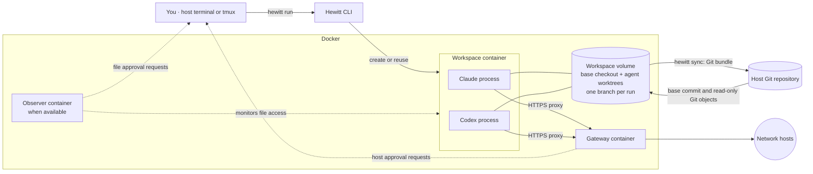

<p align="center">
  <picture>
    <source media="(prefers-color-scheme: dark)" srcset="docs/assets/hewitt-wordmark-dark.png">
    
  </picture>
</p>

<p align="center">
  <b>Run coding agents in isolated Docker workspaces on your machine.</b><br>
  The agent works freely; Hewitt keeps it within bounds.
</p>

<p align="center">
  
  
  
</p>

<p align="center">
  <a href="#install">Install</a> ·
  <a href="#quickstart">Quickstart</a> ·
  <a href="#how-it-works">How it works</a> ·
  <a href="#suspicious-requests">Suspicious requests</a> ·
  <a href="#documentation">Docs</a>
</p>

---

Hewitt runs Claude Code, Codex, OpenCode, Pi, and Antigravity in local
Docker workspaces. Each agent works in its own Git worktree and branch inside
a shared workspace volume. Your host repository stays separate; sync imports
the resulting branches when you are ready.

- **One workspace, many agents.** Matching runs reuse a container; each agent
  gets a separate worktree and branch.
- **Bring work back with Git.** `hewitt sync` imports workspace branches as
  `hewitt/<name>/<branch>` in the host repository.
- **Native logins.** Use each agent's official login flow. With the default
  network, the gateway keeps Claude's token outside the agent container.
- **Review suspicious requests.** Depending on the isolation level and observer
  availability, requests for other profiles, credential files, or unlisted
  network hosts wait for your decision.

```text
╭─ Hewitt: suspicious request needs approval ─────────────────────╮
│                                                                 │
│  #1  codex wants file                                           │
│      /hewitt/profiles/claude/claude/.credentials.json           │
│      another agent's login and settings (claude) · session api  │
│      waiting 3s; refused after about a minute without a decision│
│                                                                 │
│  [a] approve   [d] deny   [k] abort codex   [esc] later         │
╰─────────────────────────────────────────────────────────────────╯
```

## Install

Hewitt needs **Linux or macOS**, **Git**, and the **Docker CLI** with a running
Docker Engine (Docker Desktop on macOS works). It uses your current Docker
context and never manages the daemon.

```sh
go install github.com/hewitt-iso/hewitt@latest
```

Or build from source (Go 1.26 or newer):

```sh
git clone https://github.com/hewitt-iso/hewitt.git
cd hewitt && make build      # bin/hewitt
```

Prebuilt binaries and Homebrew are not published yet. Images are pulled from
`ghcr.io/hewitt-iso` on first use; agents install on first launch.

## Quickstart

```sh
hewitt login claude          # official login, saved in a private profile
cd ~/code/my-project
hewitt                       # pick an agent; it starts on its own branch
```

Open another tmux window in the same project and run `hewitt` again to add a
second agent to the same workspace. When they are done:

```sh
hewitt sync                  # import their branches into your repository
git branch --list 'hewitt/*'
```

Give an agent its task up front, or run it without its interface and collect
the result:

```sh
hewitt run claude -p "fix the flaky test in api/"
hewitt run codex --headless --prompt-file task.md   # prints the result, exits
```

The first run offers a short setup: import your agent settings (with secret
values removed), choose a workspace, and log in. Run agents inside **tmux** to
keep them reattachable and to answer requests in their panes.

## How it works

The default volume workspace keeps the host repository and the agents' working
copies separate:



1. **Run.** Hewitt finds or creates a matching workspace and starts each agent
   as a foreground process in its own worktree and branch. Uncommitted host
   changes are not copied. Your terminal owns the connection; host tmux makes
   it reattachable.
2. **Network.** On the default network, a separate gateway proxies HTTPS and
   injects Claude's token. `shared` and `isolated` have open network access;
   `restricted` and `hardened` hold connections to hosts outside the allowlist
   for approval. A custom network has no Hewitt gateway.
3. **Files.** In `isolated` and above, the observer asks before an agent opens
   another agent's profile or a credential file. It requires Linux fanotify;
   if it cannot attach, Hewitt warns and continues without it.
4. **Sync.** `hewitt sync` exports a Git bundle from the volume and imports its
   branches into the host repository. The host does not open the container's
   repository. See [Using Hewitt](docs/usage.md) for workspace lifecycle details.

## Isolation levels

| Level | Filesystem | Network | Use it for |
|---|---|---|---|
| `shared` | No host paths unless mounted | Open | Trusted helpers |
| `isolated` *(default)* | Read-write host paths need `--danger host-paths` | Open; credentials via the gateway | Everyday work |
| `restricted` | Read-only root filesystem | Allowlist; others wait for approval | Unfamiliar code |
| `hardened` | As `restricted`, in a sandbox runtime (`runsc`, Kata) | As `restricted` | Untrusted code |

```sh
hewitt run codex --isolation restricted
```

Weakening a level always takes an explicit `--danger` item. What each layer
protects, and where it stops, is in [docs/security.md](docs/security.md).

## Suspicious requests

When an enabled protection encounters a request that needs a decision, Hewitt
holds it temporarily: a **suspicious request needs approval
(SRNA)**. In host tmux it appears as a popup in the agent's pane; answer with one
key, or decide in batches from any terminal:

```sh
hewitt requests              # numbered list: session, agent, target
hewitt approve 1-3 7         # allow; later requests for the same target pass
hewitt deny 6-9              # refuse; later requests for the same target fail
hewitt abort 4 5             # refuse and stop the agents that asked
```

Numbers never change once shown. `hewitt ps` marks waiting sessions as
`SRNA (n)`. To see pending requests in your tmux status line:

```tmux
set -g status-right '#(hewitt status --tmux) %H:%M'
set -g status-interval 5
```

## Everyday commands

| Command | What it does |
|---|---|
| `hewitt` | Pick an agent or a shell and open it in the project's workspace |
| `hewitt run <agent>` | Open a specific agent: `claude`, `codex`, `opencode`, `pi`, `antigravity` |
| `hewitt run <agent> -p "<task>"` | Start the agent on a task; add `--headless` to run it without its interface |
| `hewitt shell` | Open a shell in the workspace |
| `hewitt ps` | List workspaces, their agents, and pending requests |
| `hewitt attach` | Return to a running agent's tmux pane |
| `hewitt sync` | Import a workspace's branches into your repository |
| `hewitt stop` / `hewitt rm` | Stop a workspace with all its agents / remove it after syncing |
| `hewitt login <agent>` | Log in with the agent's official flow; `hewitt auth` has status, logout, relogin |
| `hewitt requests` · `approve` · `deny` · `abort` | Review and decide suspicious requests |
| `hewitt trust` | Allow a reviewed `hewitt.yml` to apply its sensitive settings |

## Project settings

Put a `hewitt.yml` in your repository to set defaults for everyone:

```yaml
agent: claude
isolation: restricted
egress:
  allow: [pypi.org, "*.pythonhosted.org"]
limits:
  memory: 4g
```

Settings that could expose logins or host files, such as `image`, `danger`, or
an egress allowlist, apply only after you run `hewitt trust`, and again after
every change. The full reference is in [docs/configuration.md](docs/configuration.md).

## Documentation

| Guide | Contents |
|---|---|
| [Using Hewitt](docs/usage.md) | Workspaces, agents, SSH push, project dependencies, attach, errors, command reference |
| [Configuration](docs/configuration.md) | `hewitt.yml` reference, OpenTelemetry, `config.json`, session metadata |
| [Security model](docs/security.md) | Gateway, credential injection, observer, approvals, limits |
| [Legacy modes](docs/legacy-modes.md) | Worktree, direct, copy, exec, and sidecar modes |
| [Development](docs/development.md) | Building, testing, architecture, publishing images |

## Status

Hewitt is in early development. Volume workspaces, the gateway, the observer,
and suspicious request approval work on Linux; macOS runs through Docker
Desktop, and the observer there depends on its kernel. `hewitt logs` is not
implemented yet. Contributions follow [AGENTS.md](AGENTS.md).
